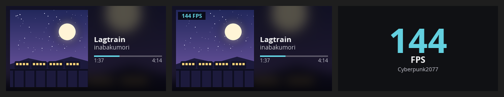

<p align="center">
  
</p>

<h1 align="center">RT85 Manager</h1>

<p align="center">
  Configure the <b>Epomaker RT85</b> keyboard on Linux: lighting, per-key colours,
  key remapping and the built-in screen.<br>
  A native <a href="https://github.com/pop-os/libcosmic">COSMIC</a> app plus the <code>rt85</code> command-line tool.
</p>

> [!WARNING]
> **Experimental.** The RT85 support is built from other projects' analyses of
> Epomaker's own driver and a USB capture of its screen upload (see
> [`docs/protocol.md`](docs/protocol.md)). It hasn't been tested by this project on an
> RT85 yet. If you own one, please open an issue with the output of `rt85 list --all`.

## Screenshots

<sub>Taken in demo mode (`RT85_DEMO=1`), which simulates a connected keyboard.</sub>

| Lighting | Per-key colours (RT85 75%) |
|---|---|
|  |  |
| **Macros** | **Screen** |
|  |  |
| **Settings** | **Device** |
|  |  |

**Live screen:** what the RT85's 320×172 screen shows for now playing, now playing + FPS, and game FPS.



## Features

- **Lighting:** the RT85's 22 built-in effects (19 on the RT100) with speed, brightness, direction, colour and rainbow mode
- **Per-key RGB:** paint keys on a clickable layout and send them to the keyboard (stored as the RT85's first user picture)
- **Key remapping:** pick a key and choose what it sends
- **Screen:** upload images and full-screen animated GIFs (fill, fit or stretch); clear the screen on the RT100
- **Screen widgets:** sync the clock, switch the RT85's screen language; stream CPU usage and temperature on the RT100
- **Macros:** key, text and delay steps on any key. A key is remapped to a spare F13–F24 code, and the app types the macro (via `/dev/uinput`) while it is running; the firmware's own macro memory isn't reverse-engineered yet
- **Live screen:** now-playing media from MPRIS (cover art, title, time bar) and game FPS from MangoHud, drawn onto the screen
- **Layouts:** the RT85's 75% board in US ANSI or UK ISO (asked on first run), with its real key slots; the RT100 board when one is detected. The keyboard is asked which model it is, since several share one USB ID
- **Desktop integration:** follows the COSMIC theme or the KDE colour scheme, optional frosted glass, window controls on KDE/GNOME
- **CLI:** everything above, scriptable, plus raw packets for protocol probing (`--layout ansi|iso`)

## Install

Download a package from [Releases](https://github.com/Ccalibur/rt85-manager/releases).
The binaries need glibc 2.35 or newer, so they run on **Ubuntu 22.04+**, **Debian 12+**,
**Fedora**, **Arch** and other current distros (x86_64).

| Package | Install and run |
|---|---|
| **Flatpak** | `flatpak install --user ./RT85_Manager-*.flatpak`<br>`flatpak run io.github.Ccalibur.Rt85Manager` |
| **Tarball** | `sudo tar -xzf rt85-manager-*.tar.gz -C /usr/local --strip-components=1`<br>`rt85-manager` |
| **AppImage** | `chmod +x RT85_Manager-*.AppImage && ./RT85_Manager-*.AppImage`<br>CLI: `./RT85_Manager-*.AppImage --cli list` |

### Required: udev rule

Without it, only root can talk to the keyboard. Packages can't install it for you:

```sh
sudo install -Dm644 resources/udev/70-epomaker-rt85.rules /etc/udev/rules.d/
sudo udevadm control --reload && sudo udevadm trigger   # then replug the keyboard
```

## Command-line examples

```console
$ rt85 list                                   # connected keyboards and their HID interfaces
$ rt85 list --all                             # every HID device (to find an unrecognised RT85)

$ rt85 modes                                  # list lighting effects
$ rt85 lighting --mode breathing --speed 3 --color 2bd4c4
$ rt85 lighting --mode spectrum-cycle --dazzle
$ rt85 color ff6a00                           # every key the same colour

$ rt85 remap CAPS "Left Ctrl"                 # Caps Lock becomes Ctrl
$ rt85 keys                                   # key names and indices

$ rt85 upload wallpaper.png --fit contain     # still image
$ rt85 upload cat.gif                         # animation (up to 56 frames)
$ rt85 clear
$ rt85 time                                   # sync the clock
$ rt85 cpu 42 && rt85 temp 55                 # set the widgets by hand
```

With the Flatpak, use `flatpak run --command=rt85 io.github.Ccalibur.Rt85Manager …`.
With the AppImage, use `./RT85_Manager-*.AppImage --cli …`.

Ready-made scripts are in [`examples/`](examples): lighting presets, a screen
slideshow, a CPU/temperature monitor, and systemd user units for hourly clock sync.

## Building from source

Needs Rust 1.93+, `libudev` and `libxkbcommon` headers (Arch: `systemd-libs libxkbcommon`;
Fedora: `systemd-devel libxkbcommon-devel`).

```sh
just run                 # GUI
just cli list            # CLI
just test                # unit tests (packets checked against captured traffic)
just dist                # release packages into dist/ (AppImage, .flatpak, tarball)
```

`just dist` compiles inside the Freedesktop 24.08 SDK so the binaries don't depend on
your machine's (possibly newer) glibc. See [`packaging/`](packaging).

Handy environment variables: `RUST_LOG=rt85=trace` (protocol logging),
`RT85_DEMO=1` (explore the UI without a keyboard), `RT85_PAGE=0..3` (start on a page).

### Project layout
```
crates/
  rt85-protocol/   packet builders + parsers, no I/O (unit-tested against captures)
  rt85-device/     hidapi discovery, transports, image/GIF loading
  rt85-cli/        `rt85` command-line tool
  rt85-gui/        `rt85-manager` libcosmic app
examples/          scripts and systemd units built on the CLI
packaging/         AppImage, Flatpak and tarball builds
resources/         .desktop, metainfo, icon, udev rule
docs/              protocol notes and screenshots
```

## Credits

Protocol details come from
[strodgers/epomaker-controller](https://github.com/strodgers/epomaker-controller) (MIT;
the bundled RT100 layout JSON is from there) and
[guysoft/rt82display](https://github.com/guysoft/rt82display) (GPL-3.0).

Licensed under [GPL-3.0](LICENSE).
