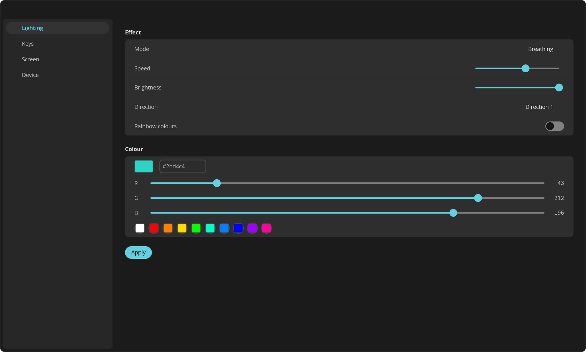
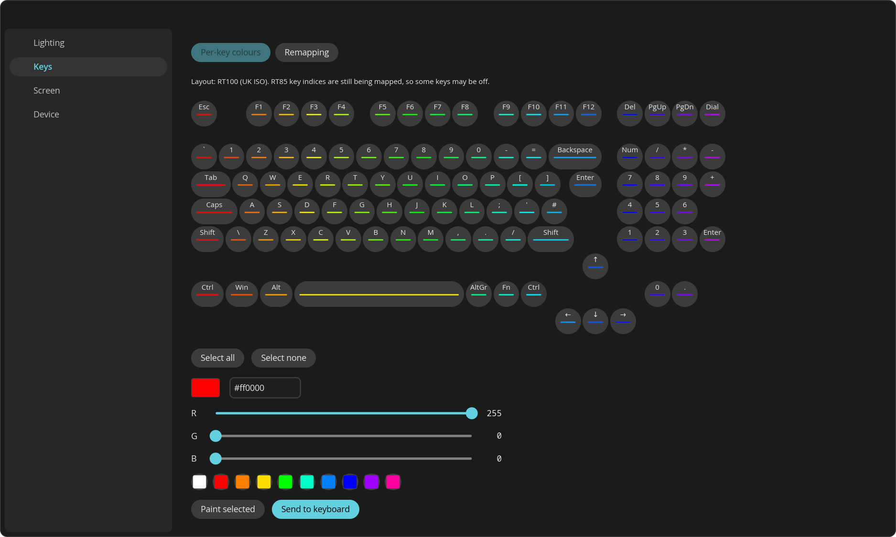
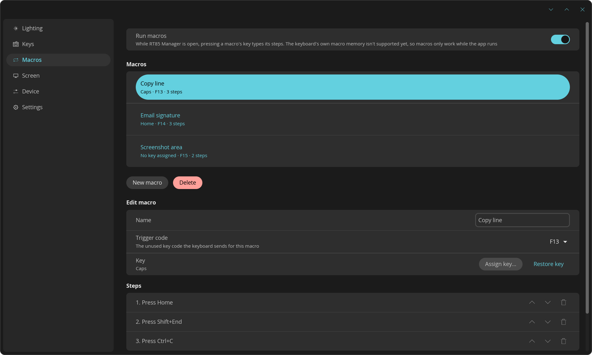
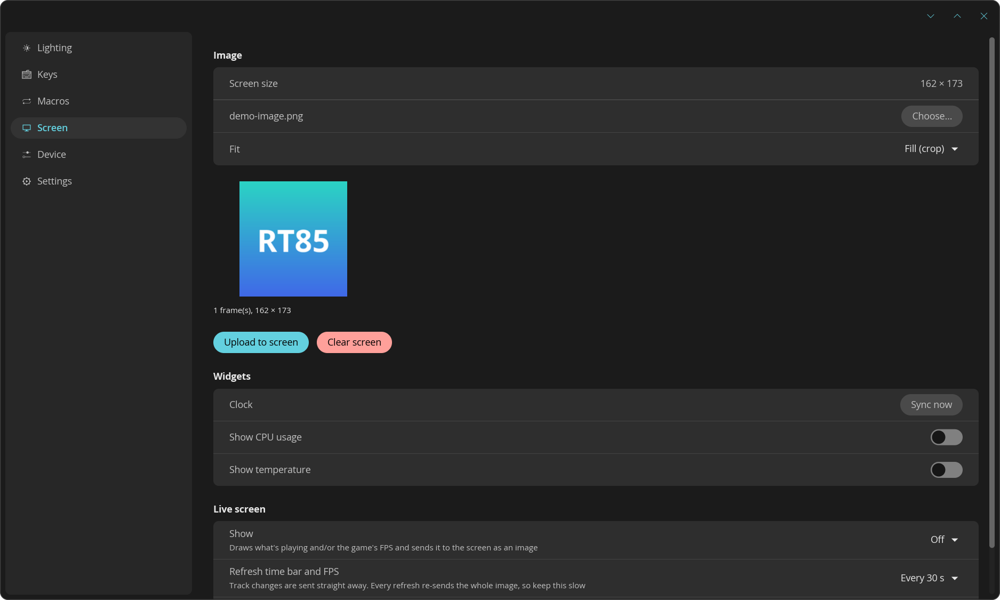
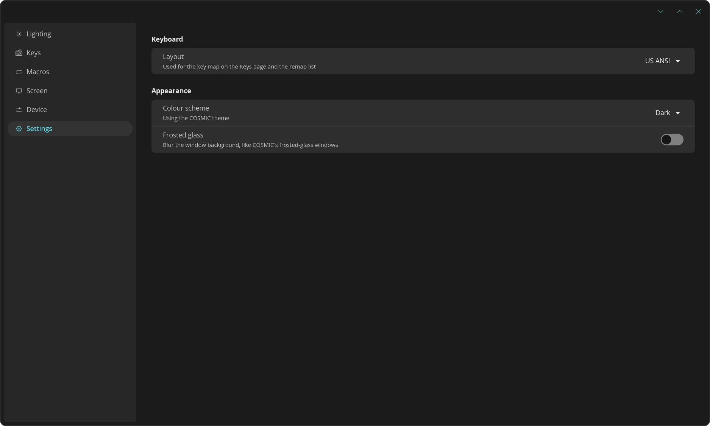
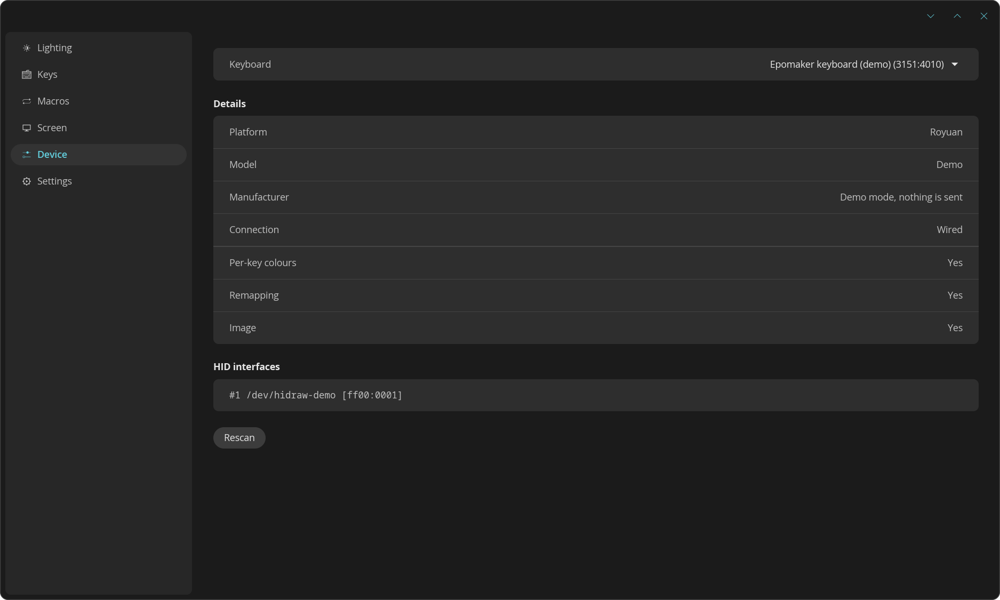

<p align="center">
  
</p>

<h1 align="center">RT85 Manager</h1>

<p align="center">
  Configure the <b>Epomaker RT85</b> keyboard on Linux: lighting, per-key colours,
  key remapping and the built-in screen.<br>
  A native <a href="https://github.com/pop-os/libcosmic">COSMIC</a> app plus the <code>rt85</code> command-line tool.
</p>

> [!WARNING]
> **Experimental, but tested on real hardware.** The app has been tested on a
> real Epomaker RT85: the features it offers work so far, including lighting,
> per-key colours, remapping, screen image/animation upload, clock sync, the
> screen language switch, live screen content and the screen reset (flash
> erase). The protocol is still reverse-engineered, so behaviour can differ on
> other models or firmware versions, and the app remains experimental. If
> something fails on your board, please open an issue with the output of
> `rt85 list --all`.

## Screenshots

<sub>Taken in demo mode (`RT85_DEMO=1`), which simulates a connected keyboard.</sub>

| Lighting | Per-key colours (RT85 75%) |
|---|---|
|  |  |
| **Macros** | **Screen** |
|  |  |
| **Settings** | **Device** |
|  |  |

**Live screen:** what the RT85's 320×172 screen shows for now playing, now playing + FPS, and game FPS. The now-playing card is the album art, the song name and a smaller artist/album line, on a background taken from the cover's colours.


## Features

- **Lighting:** the RT85's 22 built-in effects (19 on the RT100) with speed, brightness, direction, colour and rainbow mode
- **Per-key RGB:** paint keys on a clickable layout and send them to the keyboard (stored as the RT85's first user picture)
- **Key remapping:** pick a key and choose what it sends
- **Screen:** upload images and full-screen animated GIFs (fill, fit or stretch); clear the screen on the RT100, or reset the RT85's screen (erases every uploaded picture and brings the clock dashboard back, up to 90 s)
- **Screen widgets:** sync the clock, switch the RT85's screen language; stream CPU usage and temperature on the RT100
- **Macros:** key, text and delay steps on any key. A key is remapped to a spare F13–F24 code, and the app types the macro (via `/dev/uinput`) while it is running; the firmware's own macro memory isn't reverse-engineered yet
- **Live screen:** now-playing media from MPRIS (album art, song name and artist/album on a background matching the art) and game FPS from MangoHud, drawn onto the screen. Media cards are only re-sent when the song changes
- **Layouts:** the RT85's 75% board in US ANSI or UK ISO (asked on first run), with its real key slots; the RT100 board when one is detected. The keyboard is asked which model it is, since several share one USB ID
- **Desktop integration:** follows the COSMIC theme or the KDE colour scheme, optional frosted glass, window controls on KDE/GNOME
- **CLI:** everything above, scriptable, plus raw packets for protocol probing (`--layout ansi|iso`)

## Install

Download a package from [Releases](https://github.com/Ccalibur/rt85-manager/releases).
The binaries need glibc 2.35 or newer, so they run on **Ubuntu 22.04+**, **Debian 12+**,
**Fedora**, **Arch** and other current distros (x86_64). Releases ship an AppImage and a
tarball; a Flatpak can be built from [`packaging/flatpak`](packaging/flatpak) but isn't
published.

| Package | Install and run |
|---|---|
| **Tarball** | `sudo tar -xzf rt85-manager-*.tar.gz -C /usr/local --strip-components=1`<br>`rt85-manager` |
| **AppImage** | `chmod +x RT85_Manager-*.AppImage && ./RT85_Manager-*.AppImage`<br>CLI: `./RT85_Manager-*.AppImage --cli list` |

### Permissions (automatic)

The keyboard's `/dev/hidraw*` nodes are root-only until a udev rule tags the
Epomaker boards with `uaccess`. **RT85 Manager installs that rule for you** (from
0.4.0; 0.3.0 and earlier need the manual step below) the first time it detects
a keyboard: polkit asks for your password once, the
bundled rule is written to `/etc/udev/rules.d/`, and udev is reloaded and
triggered. There is no manual file copying or `sudo` step.

The CLI does the same when it needs the device, and `rt85 setup-udev` runs the
setup explicitly. It only asks for your password again if the installed rule is
missing or out of date; if the rule is current and the keyboard still isn't
accessible, unplug and replug it.

If you prefer to manage it yourself, or you built the Flatpak (whose sandbox
can't write to the host), print the bundled rule and install it once by hand:

```sh
rt85 setup-udev --print | sudo tee /etc/udev/rules.d/70-epomaker-rt85.rules
sudo udevadm control --reload && sudo udevadm trigger   # then replug the keyboard
```

From the AppImage use `./RT85_Manager-*.AppImage --cli setup-udev --print`, from
a self-built Flatpak `flatpak run --command=rt85 io.github.Ccalibur.Rt85Manager setup-udev --print`.
The rule is also in the source tree as `resources/udev/70-epomaker-rt85.rules`.

## Command-line examples

```console
$ rt85 list                                   # connected keyboards and their HID interfaces
$ rt85 list --all                             # every HID device (to find an unrecognised RT85)
$ rt85 setup-udev                             # install the udev rule now (polkit)
$ rt85 setup-udev --print                     # print the rule, to install it by hand

$ rt85 modes                                  # list lighting effects
$ rt85 lighting --mode breathing --speed 3 --color 2bd4c4
$ rt85 lighting --mode spectrum-cycle --dazzle
$ rt85 color ff6a00                           # every key the same colour

$ rt85 remap CAPS "Left Ctrl"                 # Caps Lock becomes Ctrl
$ rt85 keys                                   # key names and indices

$ rt85 upload wallpaper.png --fit contain     # still image
$ rt85 upload cat.gif                         # animation (up to 56 frames)
$ rt85 clear                                  # RT100: clear the uploaded image
$ rt85 clear --erase-flash                    # RT85: erase every picture (~90 s)
$ rt85 time                                   # sync the clock
$ rt85 cpu 42 && rt85 temp 55                 # set the widgets by hand
```

With the AppImage, use `./RT85_Manager-*.AppImage --cli …` (or, with a self-built
Flatpak, `flatpak run --command=rt85 io.github.Ccalibur.Rt85Manager …`).

Ready-made scripts are in [`examples/`](examples): lighting presets, a screen
slideshow, a CPU/temperature monitor, and systemd user units for hourly clock sync.

## Building from source

Needs Rust 1.93+, `libudev` and `libxkbcommon` headers (Arch: `systemd-libs libxkbcommon`;
Fedora: `systemd-devel libxkbcommon-devel`).

```sh
just run                 # GUI
just cli list            # CLI
just test                # unit tests (packets checked against captured traffic)
just dist                # packages into dist/ (AppImage, tarball and a .flatpak)
```

Release binaries are built in an older-glibc environment (the Freedesktop 24.08 SDK via
`just portable`, or a Debian 12 container) so they don't depend on your machine's
possibly newer glibc. See [`packaging/`](packaging).

Handy environment variables: `RUST_LOG=rt85=trace` (protocol logging),
`RT85_DEMO=1` (explore the UI without a keyboard), `RT85_PAGE=0..3` (start on a page).

### Project layout
```
crates/
  rt85-protocol/   packet builders + parsers, no I/O (unit-tested against captures)
  rt85-device/     hidapi discovery, transports, image/GIF loading
  rt85-cli/        `rt85` command-line tool
  rt85-gui/        `rt85-manager` libcosmic app
examples/          scripts and systemd units built on the CLI
packaging/         AppImage, Flatpak and tarball builds
resources/         .desktop, metainfo, icon, udev rule
docs/              protocol notes and screenshots
```

## Credits

Protocol details come from
[strodgers/epomaker-controller](https://github.com/strodgers/epomaker-controller) (MIT;
the bundled RT100 layout JSON is from there) and
[guysoft/rt82display](https://github.com/guysoft/rt82display) (GPL-3.0).

Licensed under [GPL-3.0](LICENSE).
